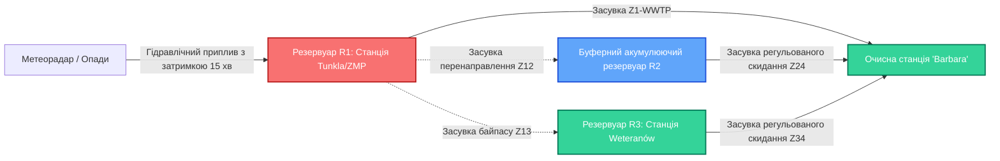

# План реалізації: Веб-аплікація моніторингу водоканалів, виявлення аномалій та динамічного перерозподілу стоків

## Опис мети
Створення інтерактивної веб-аплікації (цифрового двійника диспетчерського центру) для моніторингу та управління мережею каналізаційно-насосних станцій і резервуарів під час екстремальних опадів. 

Система розв'язує три ключові завдання:
1. **Виявлення та попередження аномалій**: раннє прогнозування ризику переповнення резервуарів (*Time to Critical, TTC*), виявлення прихованої деградації помп (*Brak wydajności*) та обривів зв'язку SCADA.
2. **Динамічний перерозподіл водних потоків**: алгоритмічний розрахунок оптимального перенаправлення надлишків води через систему керованих засувок у буферні резервуари-накопичувачі для запобігання затоплення міста.
3. **Оперативний диспетчерський інтерфейс**: візуалізація топологічної схеми з анімованими потоками води, індикацією зон підвищеного ризику, відтворенням реального історичного шторму (13.07.2024, пік 194.8 мм/год) та можливістю ручної ін'єкції аварійних сценаріїв.

---

## User Review Required

> [!IMPORTANT]
> **Використання реальних даних хакатону:**
> Для демонстрації бекенд витягує реальні часові ряди екстремальної зливи 13 липня 2024 року з файлу [`Intensywnosc opadu.csv`](file:///Users/user/Documents/Proj%20Hakaton/Dane/Ruda%20Sląska/Intensywnosc%20opadu.csv) (де зафіксовано 194.78 мм/год) та телеметрію станцій ZMP і Weteranów ([`SCADA_ZMP_2024.csv`](file:///Users/user/Documents/Proj%20Hakaton/Dane/Ruda%20Sląska/SCADA_ZMP_2024.csv)) і Chorzów ([`Wszystkie Awarie.csv`](file:///Users/user/Documents/Proj%20Hakaton/Dane/Chorzów/Dane%20do%20konkursu/Wszystkie%20Awarie.csv)).

> [!TIP]
> **Автономний запуск:**
> Проєкт буде організовано як:
> - Python FastAPI бекенд (обчислення гідравліки, детекція аномалій, оптимізація графів, WebSocket стрімінг).
> - React + Vite + Tailwind CSS фронтенд (плавна SVG/Canvas анімація, Lucide-іконки, графіки реального часу).

---

## Методи виявлення аномалій та алгоритми

### 1. Предиктивне виявлення переповнення (Hydraulic Predictive TTC)
* **Гідродинамічний лаг дощу**: приплив стоків у резервуари відстає від піку опадів на $\tau \approx 15\text{--}25$ хвилин (час добігання по міській мережі).
* **Балансове рівняння**:
  $$\frac{dV(t)}{dt} = Q_{in}(t, \text{Rain}) - Q_{out}(t)$$
* **Time-to-Critical (TTC)**:
  $$TTC = \frac{V_{max} - V(t)}{\frac{dV}{dt}}$$
  Якщо $TTC < 15$ хв або рівень $H(t) > 80\%$, система оголошує **Жовту зону небезпеки**, а при $TTC < 7$ хв або $H(t) > 90\%$ — **Червону критичну зону** (підпір / загроза затоплення).

### 2. Багатовимірна діагностика деградації помпи (Pump Health & Efficiency Anomaly)
* Контроль гідравлічного ККД: порівняння споживаної потужності $P$ (або струму $I$) і фактичної подачі $Q$:
  $$\eta(t) = \frac{\rho \cdot g \cdot Q(t) \cdot H(t)}{P(t)}$$
* Фіксація аномалії `Brak wydajności`: якщо помпа перебуває в стані `ON` ($I > I_{nominal} \cdot 0.8$), але витрата $Q \approx 0$ або $dH/dt \ge 0$ (крильчатка забита, кавітація, зріз шпонки).

### 3. Оптимізація перерозподілу потоків (Capacity-Constrained Network Balancing)
* Мережа моделюється орієнтованим графом $G=(V, E)$:
  - Вузли $V$: Головна насосна станція R1 (ZMP), Буферний резервуар-накопичувач R2, Допоміжна станція R3 (Weteranów), Центральні очисні споруди (WWTP Barbara).
  - Ребра $E$: колектори з керованими засувками $Z_{12}, Z_{13}, Z_{24}, Z_{34}$ з пропускними обмеженнями $C_{ij}$.
* Коли $TTC_{R1}$ падає нижче безпечного рівня, оптимізатор автоматично розраховує відсоток відкриття засувок для скидання надлишків у вільний буфер R2 замість аварійного скидання в міські водойми.

---

## Запропоновані зміни в проєкті

### 1. Бекенд (`backend/`)

#### [NEW] `backend/requirements.txt`
Залежності: `fastapi`, `uvicorn`, `websockets`, `pydantic`.

#### [NEW] `backend/data_loader.py`
Модуль парсингу реальних даних:
* Виділення штормової сесії 13.07.2024 з [`Intensywnosc opadu.csv`](file:///Users/user/Documents/Proj%20Hakaton/Dane/Ruda%20Sląska/Intensywnosc%20opadu.csv).
* Нормалізація SCADA-параметрів станцій Ruda Śląska для генерації реалістичного часового ряду.

#### [NEW] `backend/anomaly_detector.py`
Реалізація аналітичного ядра:
* Розрахунок `TTC` (час до переповнення).
* Детекція падіння ККД помпи (`Brak wydajności`).
* Детекція сенсорних аномалій і обривів зв'язку.

#### [NEW] `backend/network_engine.py`
Математична модель гідравлічної мережі:
* Стан резервуарів (об'єм, рівень, поріг переливу).
* Стан помп (струм, продуктивність, статус справності).
* Стан керованих засувок (ступінь відкриття 0–100%).
* Логіка автоматичного аварійного перерозподілу води між R1, R2 та R3.

#### [NEW] `backend/simulator.py`
Стрімінговий рушій симуляції (10 Гц):
* Підтримка режимів: "Історичний шторм 13.07.2024" та "Інтерактивний сценарій".
* Керування швидкістю (1x, 2x, 5x, 10x).
* Прийом команд диспетчера (ін'єкція аварії помпи, штучна хмара опадів, ручне перемикання засувок, перемикання AUTO/MANUAL).

#### [NEW] `backend/main.py`
FastAPI сервер, ендпоінти REST (`/api/status`, `/api/scenarios`, `/api/command`) та WebSocket канал `/ws/telemetry`.

---

### 2. Фронтенд (`frontend/`)

#### [NEW] `frontend/package.json`, `vite.config.ts`, `tailwind.config.js`
Конфігурація React 18 + Vite + Tailwind CSS + Lucide React + Canvas/SVG.

#### [NEW] `frontend/src/components/NetworkSchematic.tsx`
Головний компонент цифрового двійника:
* Інтерактивна топологія каналізаційної мережі.
* Анімовані резервуари з динамічною водою (хвилі, градієнт заповненості від блакитного до червоного при критичному рівні).
* Анімовані імпульсні потоки в трубах (швидкість і товщина струменя змінюються пропорційно фактичній витраті води).
* Анімовані насоси (обертання ротора при роботі, червона пульсація при аварії).
* Інтерактивні засувки (індикація відкрито/закрито, клік для ручного перемикання).
* Радарні пульсуючі кола над зонами виявленого ризику / аварії.

#### [NEW] `frontend/src/components/ControlToolbar.tsx`
Панель керування диспетчера:
* Перемикач режимів: AUTO (розумний алгоритм сам відводить воду) / MANUAL (диспетчер керує засувками).
* Кнопки швидкості симуляції: 1x, 2x, 5x, 10x, Пауза/Старт.
* Ін'єкція екстремальних подій:
  - 🌧️ "Ударна злива 150 мм/год"
  - ⚠️ "Аварія основної помпи P1"
  - ⚡ "Вимкнення зовнішнього живлення"
  - 🔄 "Скинути стан мережі"

#### [NEW] `frontend/src/components/LiveTelemetryPanel.tsx`
Графіки та KPI реального часу:
* Графік інтенсивності дощу та прогнозованого припливу.
* Рівні в резервуарах R1, R2, R3 у відсотках.
* Метрика TTC (Time To Critical Overflow) для кожної станції.
* Енергоспоживання та ККД помп.

#### [NEW] `frontend/src/components/AlertsLog.tsx`
Стрічка оперативних журналів аварій та дій автоматики (наприклад: *[14:22:10] УВАГА: Сплеск опадів >120 мм/год -> TTC станції ZMP знизився до 8 хв -> Автоматично відкрито засувку Z12 на 85% -> 1200 м³/год перенаправлено у буфер R2*).

---

## План верифікації

### Автоматизовані перевірки
1. Тест завантаження історичних даних: перевірка коректності читання файлу опадів та SCADA без помилок парсингу.
2. Тест предиктивного розрахунку TTC: перевірка того, що при зростанні припливу розрахований час до переповнення коректно знижується.
3. Тест графового перерозподілу: перевірка спрацьовування відкриття засувки Z12 при $TTC < 15$ хв та запобігання переповненню R1.
4. Тест WebSocket зв'язку: успішне підключення та отримання JSON-пакетів телеметрії клієнтом.

### Ручна верифікація в браузері
1. Відкрити веб-аплікацію в браузері (`http://localhost:5173`).
2. Запустити симуляцію шторму 13.07.2024 на швидкості 5x.
3. Переконатися, що під час зростання опадів:
   - Рівень води в резервуарі R1 піднімається.
   - Система підсвічує R1 жовтим, а потім червоним кольором при наближенні до порогу.
   - У режимі AUTO засувка Z12 відкривається, анімований потік води починає бігти в резервуар R2, знижуючи навантаження на R1.
4. Натиснути кнопку «Аварія помпи P1» — перевірити появу червоного алерту, спрацювання резервної помпи або перенаправлення засувками.
